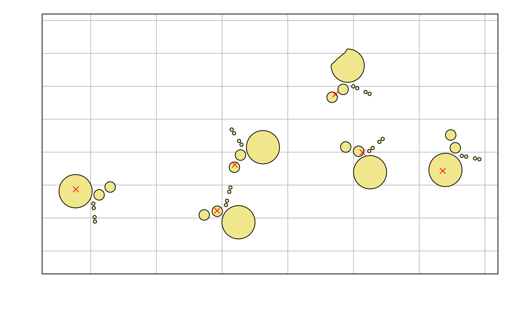
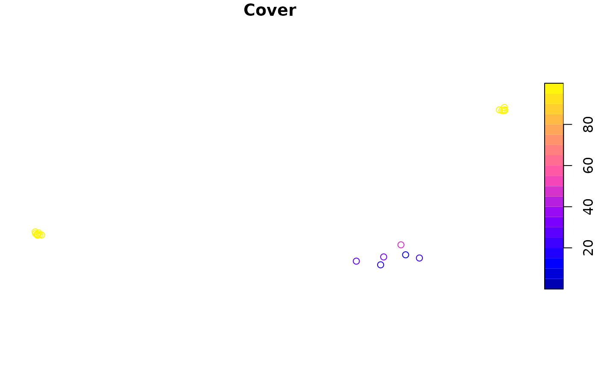

# Using the \`safedata\` package

    #> NULL

The `safedata` package makes it easy to search for and use datasets
collected from a research project using the [broader `safedata`
system](https://imperialcollegelondon.github.io/safedata/dev/articles/overview.Rmd).
It provides an interface to download data files and packaged record
metadata and then functions to load data worksheets and add taxonomic
and spatial data where available.

## Installing `safedata`

The `safedata` package is available from CRAN:

``` r

install.packages("safedata")
```

The development version can also be installed from GitHub:

``` r

devtools::install_github("ImperialCollegeLondon/safedata@main")
```

## Package dependencies

The `safedata` package requires the following packages:

- `readxl`, to read data directly from Excel datasets,
- `jsonlite`, `httr` and `curl`, to communicate with the SAFE API and to
  read downloaded JSON data,
- `chron`, to represent time of day data,
- `igraph`, to handle taxonomic data structures, and
- `sf`, to handle spatial data about sampling locations.

## The `safedata` directory structure

The `safedata` package makes use of a local directory to store
downloaded data, index and metadata files, described in more detail in
the [overview
documentation](https://imperialcollegelondon.github.io/safedata/dev/articles/overview.Rmd).
These files are needed for the `safedata` package to work, so the first
step in using `safedata` is to set the location of the directory and the
package will remind you to do this when it is loaded.

``` r

library(safedata)
#> safedata package reminder: Please set safedata directory using set_safedata_dir()
```

## Initialising a SAFE data directory

If this is the first time you are loading `safedata` then you need to
create a new, empty safedata directory. You will need the URL of the
`safedata_server` web application that holds published metadata for the
datasets in your research community.

``` r

# Create a temporary location for use in this walkthough
safe_dir_path <- file.path(tempdir(), "my_safe_directory")

# Create a new safedata directory
create_safedata_dir(
    safe_dir_path,
    url = "http://example.safedata.server"
)
```

    #> safedata directory created

    #> Loading and caching index

    #> Validating directory

This will create the directory and download the current index files. You
cannot use an existing directory: the package wants to start with a
fresh, empty directory. Note that the directory path is stored in
[`options()`](https://rdrr.io/r/base/options.html):

``` r

getOption("safedata.dir")
```

    #> [1] "/tmp/RtmpstsuBE/my_safe_directory"

## Using an existing `safedata` directory

Once you have created a `safedata` directory, you then use the
`set_safedata_dir` function to tell the `safedata` package where to look
for index and data files:

``` r

set_safedata_dir(safe_dir_path)
```

    #> Checking for updates

    #>  - Updating Index

    #>  - Updating Gazetteer

    #>  - Updating Location aliases

    #> Index files successfully updated

    #> Loading and caching index

    #> Validating directory

You will see that this function checks with the metadata server for
updates to the key index files. This can be turned off for offline use
(`set_safedata_dir('~/my_safe_directory', update=FALSE)`). The function
also validates local data files: it checks the MD5 hash of local data
file copies against the MD5 of the published data files.

## Finding data

You can browse datasets published using the `safedata` system either at
the project Zenodo site or from its metadata server. For example, for
the [SAFE
Project](https://imperialcollegelondon.github.io/safedata/dev/articles/safe_project.Rmd)
these links are:

- our [SAFE Zenodo community](https://zenodo.org/communities/safe) and
- the [SAFE Project website](https://data.safeproject.net/datasets/).

If you have done this, or have a dataset DOI from another source, then
you can look up the [dataset directly](#look-up-a-specific-dataset).
However, if you want to search the dataset metadata or the taxa and
locations covered by datasets then there are a set of search functions
built into the `safedata` package.

## Search functions

The `safedata` package contains a set of search functions to explore
datasets. These functions make use of a metadata index stored on the
SAFE Project website and so need an internet connection to work. These
search functions provide structured access to the same metadata shown in
project description text but also provide extended taxonomic and spatial
searches.

The functions are:

- [`search_text()`](https://imperialcollegelondon.github.io/safedata/dev/reference/search_safe.md):
  free text search of dataset and worksheet titles and descriptions.
- [`search_fields()`](https://imperialcollegelondon.github.io/safedata/dev/reference/search_safe.md):
  searches worksheet field names and descriptions and field types.
- [`search_authors()`](https://imperialcollegelondon.github.io/safedata/dev/reference/search_safe.md):
  searches dataset authors
- [`search_dates()`](https://imperialcollegelondon.github.io/safedata/dev/reference/search_safe.md):
  searches for overlap with the start and end date of a dataset.
- [`search_taxa()`](https://imperialcollegelondon.github.io/safedata/dev/reference/search_safe.md):
  searches for datasets containing particular taxa.
- [`search_spatial()`](https://imperialcollegelondon.github.io/safedata/dev/reference/search_safe.md):
  searches for datasets sampling at or near a particular location.

All of these functions return a `safe_record_set` objects, which is just
a data frame containing validated record ids and access information for
datasets matching your query. You can use the normal data frame indices
(e.g. `recs[1,]`) to select particular records.

``` r

soil_datasets <- search_text("soil")
```

    #> Search returned 31 records

``` r

print(soil_datasets)
#> Set includes 25 concept ids and 31 record ids: 
#>  - 25 open and most recent (*)
#>  - 6 open and outdated (o)
#>  - 0 under embargo or restricted (x)
#> 
#>    concept  record available
#> 1  1198564 3857210         *
#> 2  3247591 3247592         *
#> 3  3251886 3258079         *
#> 4  ------- 3251887         o
#> 5  3251899 3258117         *
#> 6  ------- 3251900         o
#> 7  3251901 3897394         *
#> 8  ------- 3614876         o
#> 9  ------- 3258082         o
#> 10 ------- 3251902         o
#> 11 3265745 3265746         *
#> 12 3266770 4542881         *
#> 13 ------- 3266771         o
#> 14 3266821 3266822         *
#> 15 3354067 3354068         *
#> 16 3402745 3402746         *
#> 17 3698114 3698115         *
#> 18 3888374 3888375         *
#> 19 3897376 3897377         *
#> 20 3929631 3929632         *
#> 21 3979295 3979296         *
#> 22 4297672 4297673         *
#> 23 4630979 4630980         *
#> 24 4899609 4899610         *
#> 25 5113428 5113429         *
#> 26 5113430 5113431         *
#> 27 5519571 5519572         *
#> 28 5562259 5562260         *
#> 29 6477761 6477762         *
#> 30 7307448 7307449         *
#> 31 7789415 7789416         *
```

### Taxon search details

Published datasets contain a taxonomic index of any organisms referred
to within the data. The `safedata_validator` website provides for
[details of Taxa
worksheets](https://safedata-validator.readthedocs.io/en/stable/data_providers/data_format/taxa.html)
containing the index.

The taxa in this index, along with all of the parent taxa in the
taxonomic hierarchy leading up to that those taxa, are added to the
taxonomic database on `safedata_server` web application. The
[`search_taxa()`](https://imperialcollegelondon.github.io/safedata/dev/reference/search_safe.md)
function searches that index to identify all the datasets that contain a
particular taxon.

``` r

ants <- search_taxa("Formicidae")
```

    #> Search returned 18 records

``` r

print(ants)
#> Set includes 17 concept ids and 18 record ids: 
#>  - 16 open and most recent (*)
#>  - 2 open and outdated (o)
#>  - 0 under embargo or restricted (x)
#> 
#>    concept  record available
#> 1  1198301 1198302         *
#> 2  1198471 1237732         *
#> 3  1198838 1198839         *
#> 4  1237729 1237730         *
#> 5  1400561 1400562         *
#> 6  1995247 1995439         o
#> 7  2537072 3901735         *
#> 8  3247484 3876227         *
#> 9  ------- 3247485         o
#> 10 3265745 3265746         *
#> 11 3354067 3354068         *
#> 12 3975972 3975973         *
#> 13 3979295 3979296         *
#> 14 4297672 4297673         *
#> 15 4630979 4630980         *
#> 16 5113428 5113429         *
#> 17 5562259 5562260         *
#> 18 7789415 7789416         *
```

TODO: Finalise SeqTaxa instructions.

The taxonomic index is built around the GBIF taxonomic databases. The
GBIF database only uses the following core taxonomic levels: kingdom,
phylum, class, order, family, genus, species and subspecies. Although
the NCBI uses a much wider range of taxonomic levels, we only include
these core backbone ranks for NCBI taxa, although we add superkingdom,
which is used for bacteria and viruses.

It is also possible to search the taxon index using the taxon index
number from one of GBIF or NCBI. For example, to search for the GBIF ID
for [Formicidae (4234)](https://www.gbif.org/species/4342) .

``` r

ants <- search_taxa(taxon_id = 4342, taxon_auth = "GBIF")
```

    #> Search returned 18 records

### Spatial search details

Datasets also have to provide a full index of sampling locations used in
the data. Sampling locations are either linked to existing sampling
locations included in a curated gazetteer of locations for a project or
users can identify new sampling locations and provide location data if
possible. As an example, the gazetteer for the [SAFE
project](https://imperialcollegelondon.github.io/safedata/dev/articles/safe_project.Rmd)
can be found here:

<https://data.safeproject.net/gazetteer/map/>

The
[`search_spatial()`](https://imperialcollegelondon.github.io/safedata/dev/reference/search_safe.md)
function allows users to search for datasets by sampling locations.
Accepted location names from the gazetteer can be used to search for
datasets but users can also provide their own search geometries using
the [WKT GIS
format](https://en.wikipedia.org/wiki/Well-known_text_representation_of_geometry).
The search includes simple GIS capabilities to look for sampling within
a given distance of the query location.

``` r

# Datasets that include sampling at or within named location
within_a <- search_spatial(location = "BL_A")
```

    #> Search returned 39 records

``` r

# Datasets that sampled within 2 km of a specific location
near_maliau <- search_spatial(wkt = "POINT(116.97394 4.73481)", distance = 2000)
```

    #> Search returned 78 records

    #> Warning in validate_record_ids(recids): Unknown record ids in record_set:
    #> 3490564

Note that WKT coordinates should be supplied as WGS84 longitude and
latitude - typically the output of GPS receivers - but the database uses
the local projected coordinate system for all distance calculations and
GIS operations.

### Combining searches

It is possible to combine searches using logical operators (`&` and
`|`), which simply find the intersection and unions of sets of SAFE
records.

``` r

# Three searches
fish <- search_taxa("Actinopterygii")
#> Search returned 11 records
dragonflies <- search_taxa("Odonata")
#> Search returned 9 records
ewers <- search_authors("Ewers")
#> Search returned 98 records
# Find datasets published by Ewers that reference fish or dragonflies
joint <- (fish | dragonflies) & ewers
```

Another approach is to restrict the records that will be searched in the
online database. You can pass a search result into a second search
result to only search within those records. This cuts down on the amount
of information that has to be retrieved from the server, so might be
faster on poor networks. However, this obviously only works for repeated
narrowing of a search, so has less functionality.

``` r

fish <- search_taxa("Actinopterygii")
#> Search returned 11 records
ewers <- search_authors("Ewers", ids = fish)
#> Search API unavailable:
#> Unknown curl response: Unknown URL passed to mock_handler: http://example.safedata.server/api/search/authors?name=Ewers&ids=1237719&ids=4072959&ids=3982665&ids=1478526&ids=3926374&ids=3974971&ids=6368114&ids=5820902&ids=5710509&ids=6477764&ids=7789416
```

## Look up a specific dataset

Datasets are identified by their record number, which is the number
included in both the dataset DOI and Zenodo URL. All of the following
point to the same dataset:

- <https://doi.org/10.5281/zenodo.3247631>
- [10.5281/zenodo.3247631](https://doi.org/10.5281/zenodo.3247631)
- [https://zenodo.org/record/3266821](https://zenodo.org/record/3247631)

Note that all metadata is *available for all records*, regardless of
whether they are open, embargoed or restricted. This includes field
descriptions and taxon and location sampling so that users can assess
whether a dataset is going to be useful even if it is not yet openly
available.

Once you have the details of a dataset you are interestested in then you
can validate a dataset reference to access metadata and available data,
using the
[`validate_record_ids()`](https://imperialcollegelondon.github.io/safedata/dev/reference/validate_record_ids.md)
function. This function does the following:

1.  checks that the record is valid,
2.  checks whether the record number is a **record id**, referring to a
    specific version of a dataset, or a **concept id**, which identifies
    all the versions of a dataset. In the example code below, two of the
    values are record ids, so the appropriate concept id is located and
    printed, and one is a concept id, so no specific version number is
    given.
3.  checks whether the data are currently available, and
4.  provides an interface to download and import the related data files.

Like the `search` functions, the output is `safe_record_set` object.
Note that you can validate multiple references at once.

``` r

recs <- validate_record_ids(c(
    "https://doi.org/10.5281/zenodo.3247631",
    "10.5281/zenodo.3266827",
    "https://zenodo.org/record/3266821"
))
print(recs)
```

    #> Set includes 3 concept ids and 2 record ids: 
    #>  - 2 open and most recent (*)
    #>  - 0 open and outdated (o)
    #>  - 0 under embargo or restricted (x)
    #> 
    #>   concept  record available
    #> 1 3247630 3247631         *
    #> 2 3266821 -------          
    #> 3 3266826 3266827         *

In addition, all of the main functions in `safedata` that expect to be
passed a dataset id will run
[`validate_record_ids()`](https://imperialcollegelondon.github.io/safedata/dev/reference/validate_record_ids.md)
on their inputs, so you can simply use those URLs directly with those
functions without needing to specifically create a `safe_record_set`
yourself.

## Displaying dataset metadata

Printing a `safe_record_set` object displays a deliberately compact
summary of a set of record ids. There are three function that show the
detailed metadata for records at three levels:

- the **concept** level: metadata about all the published versions of a
  particualar dataset,
- the **record** level: metadata about a specific version of a dataset,
  and
- the **worksheet** level: metadata about the fields available in a
  particular data worksheet.

### `show_concepts()`

The
[`show_concepts()`](https://imperialcollegelondon.github.io/safedata/dev/reference/show_concepts.md)
function displays concept level metadata about a set of record ids. This
includes the (most recent) dataset title and a short summary of the
versions available under the dataset concept. Note that the output is
not restricted just to the set of record ids given to the function: it
shows metadata for all versions for each of the concept ids included.

``` r

show_concepts(recs)
```

    #> 
    #> Concept ID: 3247630
    #> Title: Functional traits of tree species in old-growth and selectively logged forest
    #> Versions: 1 available, 0 embargoed or restricted
    #> 
    #>  record_id  published embargo available
    #>    3247631 2019-06-17      --         *
    #> 
    #> -------------
    #> 
    #> Concept ID: 3266821
    #> Title: Microclimate proxy measurements from a logging gradient in Malaysian Borneo (BALI project)
    #> Versions: 1 available, 0 embargoed or restricted
    #> 
    #>  record_id  published embargo available
    #>    3266822 2019-07-03      --         *
    #> 
    #> -------------
    #> 
    #> Concept ID: 3266826
    #> Title: Quantifying the spatial heterogeneity of forest conversion costs and how it relates to biodiversity, conservation and land use history
    #> Versions: 1 available, 0 embargoed or restricted
    #> 
    #>  record_id  published embargo available
    #>    3266827 2019-07-03      --         *

### `show_record()`

This function shows metadata for a specific version of a dataset: if you
give it a concept ID then it will display the available versions for
that concept. Otherwise, the function prints out information about the
dataset with that record id: it includes the dataset title, status and
other dataset level metadata and then a summary of the data worksheets
contained in the dataset.

Note that - because a `safe_record_set` is just a data frame with some
extra information attached - you can use the usual data frame indexing
to select a row to pass to other functions. Running
[`show_record()`](https://imperialcollegelondon.github.io/safedata/dev/reference/show_concepts.md)
also *requires an internet connection* when a record is first examined:
the package downloads a JSON file of the record metadata and stores it
in the SAFE data directory.

``` r

show_record(1400562)
```

    #> Downloading 1 record metadata files

    #> Downloaded metadata: 1400562

    #> 
    #> Record summary
    #> Title: Myrmecophilous Pselaphine beetles in tropical forests
    #> Authors: Psomas
    #> Publication date: 2018-08-20
    #> Record ID: 1400562
    #> Concept ID: 1400561
    #> Status: open
    #> Taxa: 
    #>  - 67 GBIF taxa reported
    #> Locations: 20 locations reported
    #> 
    #> Data worksheets:
    #>             name ncol nrow description
    #> EnvironVariables    5   20 Environmental variables
    #>         Ant-Psel    4   20 Ant-Pselaphine data
    #>   MorphAbundance   44   20 Morphospeices abundance
    #> MorphFunctTraits   18   42 Morphospecies_Functional Traits

### `show_worksheet()`

This function shows metadata for a named worksheet within a specific
record. The default is to show a compact table of field names, field
types and truncated descriptions:

``` r

show_worksheet(1400562, "EnvironVariables")
```

    #> Record ID: 1400562
    #> Worksheet name: EnvironVariables
    #> Number of data rows: 20
    #> Number of data fields: 4
    #> Description:
    #> Environmental variables
    #> Status: open
    #> 
    #> Fields:
    #>   field_name field_type description         
    #> 1 Site       Location   Site of measurements
    #> 2 Temp       Numeric    Soil temperature    
    #> 3 Moisture   Numeric    Soil moisture       
    #> 4 Cover      Numeric    Canopy cover

There is also an extended display (`extended_fields=TRUE`) that will
print out a list of all the available metadata for each field.

``` r

show_worksheet(1400562, "EnvironVariables", extended_fields = TRUE)
```

## Downloading data

Once you have found records for which you want to explore the actual
data, then you need to download the data files for the dataset from
Zenodo to work with it. There are two ways to do this.

### Bulk loading data

The
[`download_safe_files()`](https://imperialcollegelondon.github.io/safedata/dev/reference/download_safe_files.md)
function can be used to download the data files for the data records in
a `safe_record_set`, such as those created using a search.
Alternatively, you can use the URL of a safedata record or simply use
the record id for the dataset.

The function will check which datasets are currently available and
download them to the `safedata` directory. The default behaviour is to
present a brief report on the number and size of available files to be
downloaded and ask for confirmation before actually doing anything. The
`confirm=FALSE` argument can be used to download without confirmation,
which can be useful in non-interactive use. The function will also
download the JSON metadata for the specified datasets.

``` r

download_safe_files(within_a)
## 26 files requested from 26 records
##  - 0 local (0 bytes)
##  - 4 embargoed or restricted (2.2 Mb)
##  - 22 to download (43.6 Mb)
##
## 1: Yes
## 2: No
##
## Selection:
```

By default, the
[`download_safe_files()`](https://imperialcollegelondon.github.io/safedata/dev/reference/download_safe_files.md)
function downloads all of the files associated with the record. In
addition to the core Excel file, this will also download any
*additional* data files which may contain primary data that is either
not suited to the Excel format or which provides additional information,
such as PDFs. Although some additional file formats are likely to be
readable in R, the`safedata` package does not currently provide a
mechanism to load them automatically.

``` r

download_safe_files(3697804, xlsx_only = FALSE)
# 2 files requested from 1 records
#  - 1 local (11.3 Kb)
#  - 0 embargoed or restricted (0 bytes)
#  - 1 to download (74.1 Kb)
#
# 1: Yes
# 2: No
#
# Selection: 1
# 2 files for record 3697804: 1 to download
#  - Downloaded: Sampling_area_borders.xlsx
```

The function will warn you if the local copies of data files have been
altered and the `refresh=TRUE` argument can be used to restore data
files to the version of record. Note that this will **delete local
changes**.

### Loading individual datasets

The `load_safe_data` function is used to load a named data worksheet
into R. If the datafile containing the worksheet is not currently
downloaded, then `load_safe_data` will automatically download the file
if available. In this example, `confirm=FALSE` is passed onto
`download_safe_files` to remove the interactive confirmation before
downloading.

``` r

beetle_abund <- load_safe_data(1400562, "Ant-Psel", confirm = FALSE)
```

    #> Downloading datafile: Psomas_Ant_Pselaphine_SAFE_dataset.xlsx

    #> 1 files requested from 1 records
    #>  - 0 local (0 bytes)
    #>  - 0 embargoed or restricted (0 bytes)
    #>  - 1 to download (28.8 Kb)

    #> 1 files for record 1400562: 1 to download

    #>  - Downloaded: Psomas_Ant_Pselaphine_SAFE_dataset.xlsx

## The `safedata` object

Once a worksheet is loaded, it is stored as an object of class
`safedata`. This is just a data frame with some additional attribute
data and it will in general behave just like any other data frame - the
additional attributes are used for further data processing and adding
brief metadata to the `str` and `print` methods.

Some data formatting takes place based on [field
types](https://safedata-validator.readthedocs.io/en/stable/data_providers/data_format/data.html#field-types):
categorical variables are converted to factors; dates and datetimes are
converted to `POSIXct` and times are converted to `chron::time` objects.

``` r

str(beetle_abund)
```

    #> SAFE dataset
    #> Concept: 1400561; Record 1400562; Worksheet: Ant-Psel
    #> 'data.frame':    20 obs. of  3 variables:
    #>  $ Site                : chr  "SAFE_E" "SAFE_D" "SAFE_F" "SAFE_C" ...
    #>  $ ant.species.richness: num  31 31 27 29 31 21 31 25 32 26 ...
    #>  $ ant.abundance       : num  561 713 392 481 1036 ...

``` r

print(beetle_abund)
```

    #> SAFE dataset:
    #> Concept: 1400561; Record 1400562; Worksheet: Ant-Psel
    #> First 10 rows:
    #>        Site ant.species.richness ant.abundance
    #> 1    SAFE_E                   31           561
    #> 2    SAFE_D                   31           713
    #> 3    SAFE_F                   27           392
    #> 4    SAFE_C                   29           481
    #> 5    SAFE_B                   31          1036
    #> 6    SAFE_A                   21           272
    #> 7  Maliau_1                   31          1889
    #> 8  Maliau_2                   25           409
    #> 9  Maliau_3                   32           613
    #> 10 Maliau_4                   26          1036

The display of `safedata` objects is kept deliberately simple to avoid
cluttering the screen with metadata. You can always view additional
metadata for a loaded worksheet by using the `show` functions directly
on the loaded `safedata` object:

``` r

show_concepts(beetle_abund)
```

    #> 
    #> Concept ID: 1400561
    #> Title: Myrmecophilous Pselaphine beetles in tropical forests
    #> Versions: 1 available, 0 embargoed or restricted
    #> 
    #>  record_id  published embargo available
    #>    1400562 2018-08-20      --         *

``` r

show_record(beetle_abund)
```

    #> 
    #> Record summary
    #> Title: Myrmecophilous Pselaphine beetles in tropical forests
    #> Authors: Psomas
    #> Publication date: 2018-08-20
    #> Record ID: 1400562
    #> Concept ID: 1400561
    #> Status: open
    #> Taxa: 
    #>  - 67 GBIF taxa reported
    #> Locations: 20 locations reported
    #> 
    #> Data worksheets:
    #>             name ncol nrow description
    #> EnvironVariables    5   20 Environmental variables
    #>         Ant-Psel    4   20 Ant-Pselaphine data
    #>   MorphAbundance   44   20 Morphospeices abundance
    #> MorphFunctTraits   18   42 Morphospecies_Functional Traits

``` r

show_worksheet(beetle_abund)
```

    #> Record ID: 1400562
    #> Worksheet name: Ant-Psel
    #> Number of data rows: 20
    #> Number of data fields: 3
    #> Description:
    #> Ant-Pselaphine data
    #> Status: open
    #> 
    #> Fields:
    #>   field_name           field_type description                    
    #> 1 Site                 Location   Site where sample was collected
    #> 2 ant species richness Numeric    Number of ant species in sample
    #> 3 ant abundance        Abundance  Total number of ants in sample

### Dataset taxa

There are a number of functions that can be used to work with the taxa
in a dataset. Some generate simple tables of taxa:

1.  [`get_taxa()`](https://imperialcollegelondon.github.io/safedata/dev/reference/get_taxa.md):
    This function loads a dataframe containing all of the taxa used
    within a dataset, with fields including the core GBIF taxonomic
    levels, the taxonomic label used within the dataset and the
    taxonomic status of the each taxon. You can load a taxonomic
    dataframe from a `safe_record_set` row or using an existing loaded
    `safedata` object.

    ``` r

    beetle_taxa <- get_taxa(beetle_abund)
    str(beetle_taxa)
    ```

        #> Classes 'safe_taxa' and 'data.frame':    43 obs. of  16 variables:
        #>  $ superkingdom  : chr  NA NA NA NA ...
        #>  $ kingdom       : chr  "Animalia" "Animalia" "Animalia" "Animalia" ...
        #>  $ phylum        : chr  "Arthropoda" "Arthropoda" "Arthropoda" "Arthropoda" ...
        #>  $ class         : chr  "Insecta" "Insecta" "Insecta" "Insecta" ...
        #>  $ order         : chr  "Coleoptera" "Coleoptera" "Coleoptera" "Coleoptera" ...
        #>  $ family        : chr  "Pselaphidae" "Pselaphidae" "Staphylinidae" "Staphylinidae" ...
        #>  $ genus         : chr  NA NA "Mnia" "Aphilia" ...
        #>  $ species       : chr  NA NA NA NA ...
        #>  $ subspecies    : chr  NA NA NA NA ...
        #>  $ variety       : chr  NA NA NA NA ...
        #>  $ form          : chr  NA NA NA NA ...
        #>  $ worksheet_name: chr  "Psel1" "Psel10" "Psel11" "Psel12" ...
        #>  $ taxon_name    : chr  "Psel1" "Psel10" "Psel11" "Psel12" ...
        #>  $ taxon_rank    : chr  "morphospecies" "morphospecies" "morphospecies" "morphospecies" ...
        #>  $ taxon_status  : chr  "user" "user" "user" "user" ...
        #>  $ taxon_auth    : chr  "GBIF" "GBIF" "GBIF" "GBIF" ...
        #>  - attr(*, "metadata")=List of 1
        #>   ..$ safe_record_set:Classes 'safe_record_set' and 'data.frame':    1 obs. of  5 variables:
        #>   .. ..$ concept    : int 1400561
        #>   .. ..$ record     : num 1400562
        #>   .. ..$ available  : logi TRUE
        #>   .. ..$ most_recent: int 1400562
        #>   .. ..$ mra        : int 1400562

2.  [`add_taxa()`](https://imperialcollegelondon.github.io/safedata/dev/reference/add_taxa.md):
    This function adds taxonomic details to an already loaded data
    worksheet.

    ``` r

    beetle_morph <- load_safe_data(1400562, "MorphFunctTraits")
    beetle_morph <- add_taxa(beetle_morph)
    str(beetle_morph)
    ```

        #> SAFE dataset
        #> Concept: 1400561; Record 1400562; Worksheet: MorphFunctTraits
        #> 'data.frame':    42 obs. of  32 variables:
        #>  $ Morphospecies: chr  "Psel1" "Psel2" "Psel3" "Psel4" ...
        #>  $ AL           : num  0.663 0.702 0.702 1.599 1.131 ...
        #>  $ TAL          : num  0.117 0.039 0.39 0.234 0.234 0.273 0.078 0.351 0.117 0.156 ...
        #>  $ TAW          : num  0.117 0.039 0.195 0.117 0.234 0.234 0.078 0.234 0.078 0.078 ...
        #>  $ AN           : num  11 11 7 11 11 7 11 7 11 11 ...
        #>  $ HCA          : Factor w/ 2 levels "absent","present": 2 2 2 2 1 1 2 1 2 2 ...
        #>  $ HCP          : Factor w/ 2 levels "absent","present": 1 1 1 1 2 2 1 2 1 1 ...
        #>  $ TA           : Factor w/ 2 levels "absent","present": 2 2 2 2 1 1 2 2 2 2 ...
        #>  $ TP           : Factor w/ 2 levels "absent","present": 1 1 1 1 2 2 1 1 1 1 ...
        #>  $ FP           : Factor w/ 2 levels "absent","present": 1 2 2 2 2 2 2 2 2 2 ...
        #>  $ FA           : Factor w/ 2 levels "absent","present": 2 1 1 1 1 1 1 1 1 1 ...
        #>  $ Bef2         : Factor w/ 2 levels "absent","present": 2 1 1 1 2 1 2 1 2 2 ...
        #>  $ Bef3         : Factor w/ 2 levels "absent","present": 1 2 1 1 1 1 1 1 1 1 ...
        #>  $ Bef1         : Factor w/ 2 levels "absent","present": 1 1 2 2 1 2 1 2 1 1 ...
        #>  $ Bef0         : Factor w/ 2 levels "absent","present": 1 1 1 1 1 1 1 1 1 1 ...
        #>  $ Bef4         : Factor w/ 2 levels "absent","present": 1 1 1 1 1 1 1 1 1 1 ...
        #>  $ Myrmycophile : Factor w/ 4 levels "Facultative",..: NA 2 1 1 4 1 2 1 NA NA ...
        #>  $ superkingdom : chr  NA NA NA NA ...
        #>  $ kingdom      : chr  "Animalia" "Animalia" "Animalia" "Animalia" ...
        #>  $ phylum       : chr  "Arthropoda" "Arthropoda" "Arthropoda" "Arthropoda" ...
        #>  $ class        : chr  "Insecta" "Insecta" "Insecta" "Insecta" ...
        #>  $ order        : chr  "Coleoptera" "Coleoptera" "Coleoptera" "Coleoptera" ...
        #>  $ family       : chr  "Pselaphidae" "Staphylinidae" "Staphylinidae" "Staphylinidae" ...
        #>  $ genus        : chr  NA "Bibloporus" "Plagiophorus" "Harmophorus" ...
        #>  $ species      : chr  NA NA NA NA ...
        #>  $ subspecies   : chr  NA NA NA NA ...
        #>  $ variety      : chr  NA NA NA NA ...
        #>  $ form         : chr  NA NA NA NA ...
        #>  $ taxon_name   : chr  "Psel1" "Psel2" "Psel3" "Psel4" ...
        #>  $ taxon_rank   : chr  "morphospecies" "morphospecies" "morphospecies" "morphospecies" ...
        #>  $ taxon_status : chr  "user" "user" "user" "user" ...
        #>  $ taxon_auth   : chr  "GBIF" "GBIF" "GBIF" "GBIF" ...

3.  The `get_taxon_coverage` function can be used to get a taxon table
    of all taxa currently referenced in *all* datasets.

    ``` r

    all_taxa <- get_taxon_coverage()
    ```

The other functions convert taxon tables into graphs (vertices and
edges) and phylogenetic trees using the GBIF taxonomic backbone to
represent phylogeny. The data validation should ensure that the taxa in
a dataset can be connected as a phylogenetic tree, but this is not
always the case. For this reason, these functions use a more general
graph conversion and then checks whether the result can be converted to
a phlyogenetic tree. Technically, that is checking that the graph is a
connected, simple, directed acyclic graph.

1.  The `get_taxon_graph` function converts a taxon table to a graph.
    The function also does some extra validation, and will give warnings
    when the taxon table has to be adjusted to represent the taxonomic
    hierarchy and worksheet taxa properly. The result is an object of
    class `igraph` and the vertices have attributes containing the
    original table data.

2.  The `igraph_to_phylo` function tests whether a taxon graph can be
    converted to a phylogeny and returns a `phylo` object (package
    `ape`). The tips and internal nodes are labelled with taxon names
    but the `phylo` structure does not store other node information.

3.  [`get_phylogeny()`](https://imperialcollegelondon.github.io/safedata/dev/reference/igraph_to_phylo.md):
    This is simply a wrapper that runs both functions above in turn to
    go straight to a phylogeny.

    ``` r

    library(ape)
    beetle_phylo <- get_phylogeny(1400562)
    plot(beetle_phylo, show.node.label = TRUE, font = 1, no.margin = TRUE)
    ```

    

### Dataset locations

Datasets in the `safedata` system will often include observations at
spatial locations, and these datasets must include a Locations worksheet
used as an spatial index for research activities. There are three
functions that can be used to work with locations in a dataset. All of
these functions use the `sf` package to represent the GIS geometry of
locations and which provides an extensive toolset for further spatial
analysis.

1.  [`load_gazetteer()`](https://imperialcollegelondon.github.io/safedata/dev/reference/load_gazetteer.md):
    The gazetteer is one of the three key index files saved in the SAFE
    data directory and updated when
    [`set_safedata_dir()`](https://imperialcollegelondon.github.io/safedata/dev/reference/set_safedata_dir.md)
    is run. It includes sampling locations drawn from across a wide
    range of projects running at SAFE and is intended to hold all
    locations that are likely to see repeated sampling. Locations
    included the gazetteer can be used directly as **known locations**
    in datasets, although data providers can also include **new
    locations**.

    ``` r

    gazetteer <- load_gazetteer()
    print(gazetteer)
    ```

        #> Simple feature collection with 5171 features and 15 fields
        #> Geometry type: GEOMETRY
        #> Dimension:     XY
        #> Bounding box:  xmin: 116.9471 ymin: 4.41215 xmax: 117.9959 ymax: 4.961828
        #> Geodetic CRS:  WGS 84
        #> First 10 features:
        #>      location                type plot_size display_order parent region
        #> 1   SAFE_camp       SAFE basecamp      <NA>             3   <NA>   SAFE
        #> 2  Flux_tower          Flux tower      <NA>             7   <NA>   SAFE
        #> 3         A_1 SAFE Sampling point 25m x 25m             7   <NA>   SAFE
        #> 4         A_2 SAFE Sampling point 25m x 25m             7   <NA>   SAFE
        #> 5         A_3 SAFE Sampling point 25m x 25m             7   <NA>   SAFE
        #> 6         A_4 SAFE Sampling point 25m x 25m             7   <NA>   SAFE
        #> 7         A_5 SAFE Sampling point 25m x 25m             7   <NA>   SAFE
        #> 8         A_6 SAFE Sampling point 25m x 25m             7   <NA>   SAFE
        #> 9         A_7 SAFE Sampling point 25m x 25m             7   <NA>   SAFE
        #> 10        A_8 SAFE Sampling point 25m x 25m             7   <NA>   SAFE
        #>    fractal_order transect_order centroid_x centroid_y
        #> 1             NA             NA   117.6009   4.723797
        #> 2             NA             NA   117.6032   4.717283
        #> 3              1              1   117.6515   4.708505
        #> 4              1              1   117.6511   4.708578
        #> 5              1              1   117.6514   4.708950
        #> 6              1              2   117.6524   4.709513
        #> 7              1              2   117.6520   4.709589
        #> 8              1              2   117.6523   4.709968
        #> 9              1              3   117.6538   4.711672
        #> 10             1              3   117.6542   4.711600
        #>                                   source bbox_xmin bbox_ymin bbox_xmax
        #> 1                    Safe_camp_multi.shp  117.6001  4.723253  117.6016
        #> 2                               GPS data  117.6032  4.717283  117.6032
        #> 3  SAFE_core_sampling_stations_WGS84.shp  117.6515  4.708505  117.6515
        #> 4  SAFE_core_sampling_stations_WGS84.shp  117.6511  4.708578  117.6511
        #> 5  SAFE_core_sampling_stations_WGS84.shp  117.6514  4.708950  117.6514
        #> 6  SAFE_core_sampling_stations_WGS84.shp  117.6524  4.709513  117.6524
        #> 7  SAFE_core_sampling_stations_WGS84.shp  117.6520  4.709589  117.6520
        #> 8  SAFE_core_sampling_stations_WGS84.shp  117.6523  4.709968  117.6523
        #> 9  SAFE_core_sampling_stations_WGS84.shp  117.6538  4.711672  117.6538
        #> 10 SAFE_core_sampling_stations_WGS84.shp  117.6542  4.711600  117.6542
        #>    bbox_ymax                       geometry
        #> 1   4.724475 MULTIPOLYGON (((117.6007 4....
        #> 2   4.717283      POINT (117.6032 4.717283)
        #> 3   4.708505      POINT (117.6515 4.708505)
        #> 4   4.708578      POINT (117.6511 4.708578)
        #> 5   4.708950       POINT (117.6514 4.70895)
        #> 6   4.709513      POINT (117.6524 4.709513)
        #> 7   4.709589       POINT (117.652 4.709589)
        #> 8   4.709968      POINT (117.6523 4.709968)
        #> 9   4.711672      POINT (117.6538 4.711672)
        #> 10  4.711600        POINT (117.6542 4.7116)

2.  [`get_locations()`](https://imperialcollegelondon.github.io/safedata/dev/reference/get_locations.md):
    This function returns an `sf` object containing the locations used
    within a dataset. For known locations, the GIS data for the location
    are taken directly from the gazetteer. If the locations are new
    sampling sites, then GIS data provided in the dataset is used. Note
    that it is possible for dataset providers to create a new locations
    without including GIS data - these will be represented using empty
    GIS geometries.

    By default, the returned `sf` object will only include the location
    name used in the dataset, the gazetteer name for known sampling
    sites and an indication of whether the location is new or known, but
    `gazetteer_info=TRUE` can be used to include the gazetteer
    attributes for known locations.

    ``` r

    library(sf)
    ```

        #> Linking to GEOS 3.12.1, GDAL 3.8.4, PROJ 9.4.0; sf_use_s2() is TRUE

    ``` r

    beetle_locs <- get_locations(1400562)
    print(beetle_locs)
    ```

        #> Simple feature collection with 20 features and 3 fields
        #> Geometry type: POINT
        #> Dimension:     XY
        #> Bounding box:  xmin: 116.967 ymin: 4.69223 xmax: 117.7981 ymax: 4.97022
        #> Geodetic CRS:  WGS 84
        #> First 10 features:
        #>          gazetteer_name dataset_name new_location                 geometry
        #> Maliau_1             NA     Maliau_1         TRUE POINT (116.9707 4.74462)
        #> Maliau_2             NA     Maliau_2         TRUE POINT (116.9748 4.74548)
        #> Maliau_3             NA     Maliau_3         TRUE POINT (116.9675 4.74757)
        #> Maliau_4             NA     Maliau_4         TRUE POINT (116.9714 4.74565)
        #> Maliau_5             NA     Maliau_5         TRUE POINT (116.9781 4.74501)
        #> Maliau_6             NA     Maliau_6         TRUE POINT (116.9669 4.75054)
        #> Maliau_7             NA     Maliau_7         TRUE POINT (116.9731 4.74864)
        #> Maliau_8             NA     Maliau_8         TRUE POINT (116.9701 4.74607)
        #> Danum_1              NA      Danum_1         TRUE  POINT (117.796 4.96444)
        #> Danum_2              NA      Danum_2         TRUE POINT (117.7932 4.96486)

    ``` r

    fragments <- subset(gazetteer, type == "SAFE forest fragment")
    par(mar = c(3, 3, 1, 1))
    plot(st_geometry(fragments), col = "khaki", graticule = TRUE)
    plot(st_geometry(beetle_locs), add = TRUE, col = "red", pch = 4)
    ```

    

3.  [`add_locations()`](https://imperialcollegelondon.github.io/safedata/dev/reference/add_locations.md):
    This functions adds location data to an already loaded worksheet.
    The result is a `safedata` object that is also an `sf` object.

    ``` r

    beetle_env <- load_safe_data(1400562, "EnvironVariables")
    beetle_env <- add_locations(beetle_env)
    print(beetle_env)
    ```

        #> SAFE dataset:
        #> Concept: 1400561; Record 1400562; Worksheet: EnvironVariables
        #> Simple feature collection with 20 features and 7 fields
        #> Geometry type: POINT
        #> Dimension:     XY
        #> Bounding box:  xmin: 116.967 ymin: 4.69223 xmax: 117.7981 ymax: 4.97022
        #> Geodetic CRS:  WGS 84
        #> First 10 features:
        #>              Site     Temp Moisture Cover gazetteer_name dataset_name
        #> SAFE_E     SAFE_E 23.26667 40.73333    16             NA       SAFE_E
        #> SAFE_D     SAFE_D 23.76667 36.24000    32             NA       SAFE_D
        #> SAFE_F     SAFE_F 23.93333 26.71333    30             NA       SAFE_F
        #> SAFE_C     SAFE_C 22.80000 35.90667    15             NA       SAFE_C
        #> SAFE_B     SAFE_B 23.93333 20.96000    47             NA       SAFE_B
        #> SAFE_A     SAFE_A 23.73333 20.43333    23             NA       SAFE_A
        #> Maliau_1 Maliau_1 24.10000 18.08000   100             NA     Maliau_1
        #> Maliau_2 Maliau_2 24.00000 27.59000   100             NA     Maliau_2
        #> Maliau_3 Maliau_3 24.43333 14.46000   100             NA     Maliau_3
        #> Maliau_4 Maliau_4 25.00000 15.68667   100             NA     Maliau_4
        #>          new_location                 geometry
        #> SAFE_E           TRUE POINT (117.5785 4.69223)
        #> SAFE_D           TRUE POINT (117.5839 4.70618)
        #> SAFE_F           TRUE POINT (117.5355 4.69872)
        #> SAFE_C           TRUE POINT (117.6227 4.70994)
        #> SAFE_B           TRUE POINT (117.6145 4.72757)
        #> SAFE_A           TRUE  POINT (117.6472 4.7043)
        #> Maliau_1         TRUE POINT (116.9707 4.74462)
        #> Maliau_2         TRUE POINT (116.9748 4.74548)
        #> Maliau_3         TRUE POINT (116.9675 4.74757)
        #> Maliau_4         TRUE POINT (116.9714 4.74565)

    ``` r

    plot(beetle_env["Cover"], key.pos = 4, breaks = seq(0, 100, by = 5))
    ```

    

## Inserting datasets

If you want access to a dataset that is currently embargoed or
restricted, then you can approach the authors listed on the Zenodo
record to ask for permission to use the data. If you are then provided
with the files for the dataset, then they need to be inserted into your
local SAFE data directory so that they can be accessed by the `safedata`
functions.

The `insert_dataset` function does this: it will check to see if a set
of files are part of specified Zenodo record and then copy them into the
correct places in the current SAFE data directory.

``` r

files <- system.file("api_data", "template_ClareWfunctiondata.xlsx",
    package = "safedata"
)
insert_dataset(1237719, files)
```

    #> Downloading 1 record metadata files

    #> Downloaded metadata: 1237719

    #> Inserting files: template_ClareWfunctiondata.xlsx

``` r

dat <- load_safe_data(1237719, "Data")
str(dat)
```

    #> SAFE dataset
    #> Concept: 1198840; Record 1237719; Worksheet: Data
    #> 'data.frame':    34 obs. of  11 variables:
    #>  $ taxon_name              : chr  "Anguilla.borneensis" "Anguilla.marmorata" "Barbodes.sealei" "Barbonymus.balleroides" ...
    #>  $ Body_size               : num  24.14 30.56 8.51 11.36 7.59 ...
    #>  $ body_shape              : Factor w/ 3 levels "Compressed","Cylindrical",..: 2 2 1 1 1 2 1 2 1 2 ...
    #>  $ trophic_position        : Factor w/ 4 levels "Herbivore","Higher carnivore",..: 2 2 4 3 3 2 2 1 3 1 ...
    #>  $ mouth_position          : Factor w/ 3 levels "Inferior","Superior",..: 3 3 3 3 3 3 3 1 3 1 ...
    #>  $ presence_teeth          : Factor w/ 2 levels "no","yes": 2 2 1 1 2 2 1 1 1 1 ...
    #>  $ gregariousness          : Factor w/ 2 levels "no","yes": 1 1 2 2 1 1 1 2 2 2 ...
    #>  $ presence_barbels        : Factor w/ 2 levels "no","yes": 2 2 2 2 1 2 2 2 1 2 ...
    #>  $ vertical_position_water : Factor w/ 4 levels "Benthic","Benthopelagic",..: 2 2 3 3 2 2 2 2 3 1 ...
    #>  $ air.breathing_capability: chr  "yes" "yes" "no" "no" ...
    #>  $ air-breathing_capability: Factor w/ 0 levels: NA NA NA NA NA NA NA NA NA NA ...

## File details and accessing files

At the moment, the `safedata` package only handles loading data from the
core Excel files. We do intend to add functions and recipes to access
other files stored within a dataset in the future. At the moment, if you
have downloaded all the files associated with a dataset then the
`get_file_details` function allows you to quickly see a list of the
files in a dataset, whether you have downloaded a local copy and the
absolute file path of those files.

    #>                            filename dataset_access
    #> 42 template_ClareWfunctiondata.xlsx           open
    #>                                                                                  path
    #> 42 /tmp/RtmpstsuBE/my_safe_directory/1198840/1237719/template_ClareWfunctiondata.xlsx
    #>    local
    #> 42  TRUE

    #> NULL
